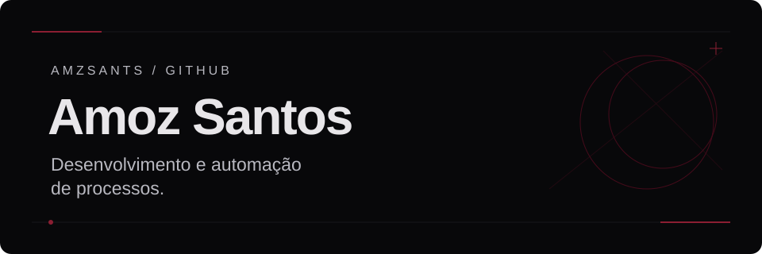
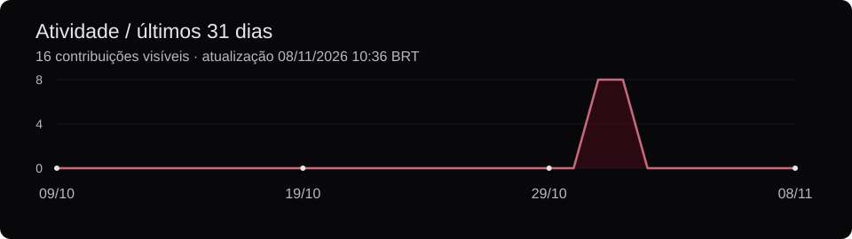
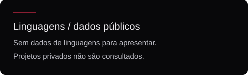
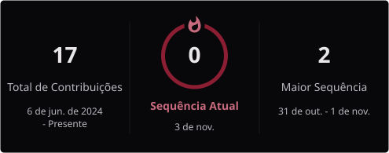
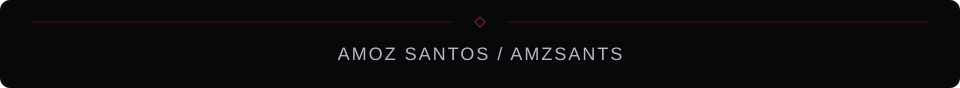

  

  

## Entre a rotina e o código

Me chamo **Amoz Santos**, aprendiz na função de auxiliar administrativo. A rotina administrativa é meu ponto de partida para pensar em desenvolvimento de software e automação de processos.

Tenho interesse em RPA e em como a tecnologia pode apoiar tarefas do dia a dia. Também utilizo ferramentas de inteligência artificial e exploro suas possibilidades.

## Ferramentas e interesses

  

**Quero explorar:** desenvolvimento de software · automação de processos · RPA.

## Projetos

Meus projetos estão em repositórios privados. No momento, não tenho projetos públicos para apresentar aqui.

## Atividade no GitHub

  

  
Estatísticas, linguagens e sequência de contribuições

   

  

    
  

  

    
  

  

    
  

  
As linguagens refletem o conteúdo dos repositórios públicos, não um nível de domínio. O repositório deste perfil é excluído desse cálculo. Os indicadores podem ter períodos e critérios diferentes; projetos privados não são acessados por esta configuração.

 

  <picture>
    <source media="(prefers-color-scheme: dark)" srcset="./assets/snake-dark.svg" />
    <source media="(prefers-color-scheme: light)" srcset="./assets/snake-light.svg" />
    
  </picture>

  

